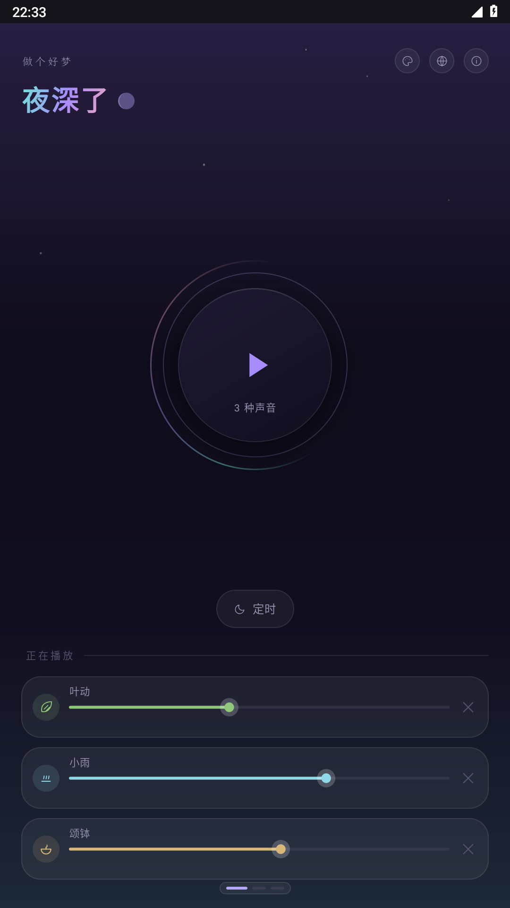
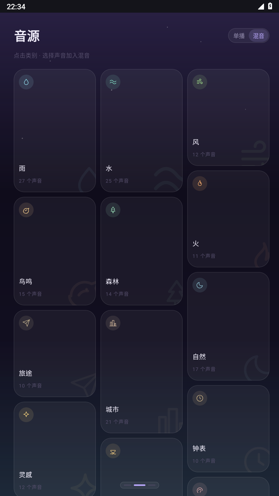
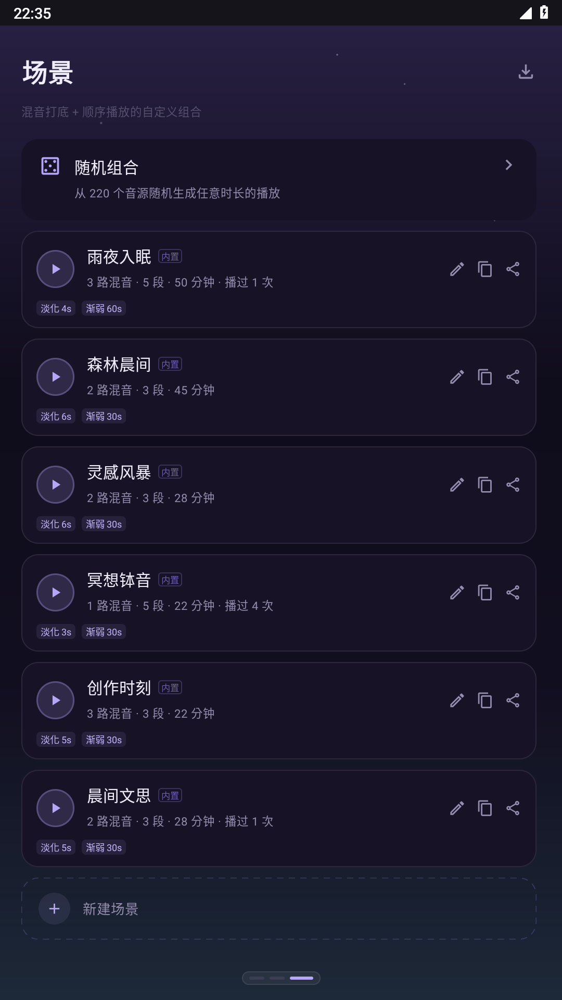

# 眠音 SleepSound · 环境音助眠 App

Android 原生的环境音与声景应用。**220 条音源、15 个声景域、18 种界面语言**，全部打包在 APK 内，飞行模式下也能播放。

本仓库**只发布 APK 与介绍，不包含源码**。

- 全离线：音源内置，播放过程不联网、不加载、不缓冲
- 无账号：不注册、不登录、不收集个人信息
- 一次安装：无需部署服务器，装完即用

## 下载

[**⬇ 下载最新版 APK**](https://github.com/fyworld/sleepsound/releases/latest) · Android 8.0+ · 约 320 MB

官网：[sleepsound.cn](https://sleepsound.cn)（国内直连，GitHub 慢的时候走这里）

> APK 约 320 MB，因为 220 条音源是原始码率打进包里的（AAC 96 kbps 立体声 44.1 kHz），没有为了体积降质。建议 Wi-Fi 下载。

## 截图

<table>
<tr>
<td align="center"> 混音播放 · 定时</td>
<td align="center"> 音源分类</td>
<td align="center"> 场景与随机组合</td>
</tr>
</table>

## 功能

- **220 条音源**：雨、水、火、风、鸟鸣、森林、自然、城市、旅途、钟表、灵感等 15 个声景域
- **混音台**：多路同时播放，每路独立音量，支持混音打底
- **场景**：6 个内置场景 + 自定义场景（混音组合 + 顺序播放 + 时长 + 淡入淡出），支持随机组合随时长生成
- **定时与渐弱**：定时关闭、淡化淡入、渐弱收尾，睡着后自然停止
- **后台播放**：通知栏 / 锁屏控制，息屏不断
- **18 种语言**：含阿拉伯语、希伯来语等 RTL 布局
- **完全离线**：播放不依赖网络，地铁、飞机、断网都不影响

## 版本与价格

| 渠道 | 说明 |
|---|---|
| 国内版（本仓库 APK） | ¥12 一次性买断，绑定本机；换机需重新购买 |
| Google Play 版 | 应用内购买，绑定 Google 账号，换机可恢复 |

国内版付款走支付宝（APP 支付 / 手机网站支付两条路径），付款成功后自动下发激活码并解锁。

## 系统要求

- Android 8.0（API 26）及以上
- 需要约 400 MB 可用存储空间（含解压）
- 权限：仅前台播放与通知所需，不申请通讯录、位置、相册等

## 隐私

不收集任何个人信息，不做用户画像，不接入第三方统计 SDK。播放数据全部留在本机。

隐私政策：<https://sleepsound.cn/privacy/>

## 说明

- 本仓库不提供源代码，音源素材与实现版权归作者所有，APK 仅供个人使用，请勿二次分发或反编译
- 应用内更新会读取 <https://sleepsound.cn/sleepsound/update.json>；GitHub 版本需要手动下载覆盖安装（同签名，解锁状态保留）
- 遇到问题请开 [Issue](https://github.com/fyworld/sleepsound/issues)，或邮件联系

## 联系

邮箱：<smwuhua@163.com> · 官网：<https://sleepsound.cn>
